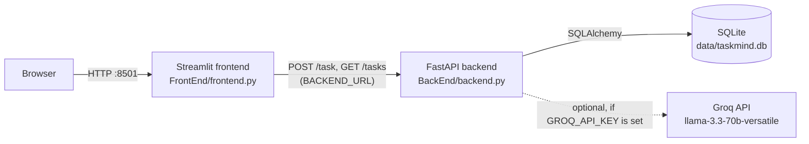

# TaskMind

[](https://github.com/kernelbits/TaskMind/actions/workflows/ci-cd.yml)

TaskMind turns a plain-language task such as *"Call the dentist tomorrow, it's urgent"* into a structured to-do item with a title, priority, category and deadline. A Streamlit UI talks to a FastAPI service, which stores tasks in SQLite and uses the Groq API for parsing when a key is configured.

## Architecture



- **Frontend** (`FrontEnd/frontend.py`): a form to add a task and a color-coded table of all tasks.
- **Backend** (`BackEnd/backend.py`): two REST endpoints, SQLAlchemy models, and the task parser.
- **Parser**: sends the task text to Groq in JSON mode. Without an API key, or if the call fails, a keyword-based fallback parser is used.

## Features

- Add a task in free text; the backend extracts title, priority (High / Medium / Low), category, deadline and notes.
- Keyword fallback parsing so the app works fully offline without an API key.
- Tasks are stored with `created_at` / `updated_at` timestamps.
- Interactive API documentation generated by FastAPI at `/docs`.
- Separate Dockerfiles for frontend and backend, plus Docker Compose files for local and prod-image runs.

## API

| Method | Path     | Description                                           | Request body                 | Response            |
|--------|----------|-------------------------------------------------------|------------------------------|---------------------|
| POST   | `/task`  | Parse a free-text task and store it                   | `{"original_text": "..."}`   | Created task (200)  |
| GET    | `/tasks` | List all stored tasks                                 | -                            | Array of tasks      |

A task has the fields `id`, `original_text`, `title`, `priority`, `deadline`, `category`, `notes`, `created_at` and `updated_at`.

## Tech Stack

- **Backend:** Python 3.11, FastAPI, Pydantic, SQLAlchemy 2 (SQLite)
- **Frontend:** Streamlit, pandas, requests
- **AI parsing:** Groq Python SDK (optional)
- **Testing:** pytest, FastAPI `TestClient`, flake8
- **Packaging and delivery:** Docker, Docker Compose, GitHub Actions, Docker Hub, Railway config files

## Setup and Run

### Option 1: Local Python

Requires Python 3.11+ (CI uses 3.11).

```bash
python -m venv .venv
source .venv/bin/activate        # Windows: .venv\Scripts\activate
pip install -r requirements.txt

# Terminal 1: backend, run from the repo root so data/ is created next to the code
uvicorn backend:app --app-dir BackEnd --port 8000

# Terminal 2: frontend
BACKEND_URL=http://localhost:8000 streamlit run FrontEnd/frontend.py
```

On Windows PowerShell, set the variable with `$env:BACKEND_URL="http://localhost:8000"` before running Streamlit.

Then open http://localhost:8501 for the UI and http://localhost:8000/docs for the API docs.

### Option 2: Docker Compose

```bash
cp .env.example .env             # Compose requires this file; GROQ_API_KEY may stay empty
docker compose up --build
```

- Frontend: http://localhost:8501
- Backend API: http://localhost:8000/docs

The backend stores its SQLite file in `./data`, which is mounted into the container.

### Environment variables

| Variable       | Used by   | Required | Default                 | Purpose                                                  |
|----------------|-----------|----------|-------------------------|----------------------------------------------------------|
| `GROQ_API_KEY` | backend   | No       | empty (fallback parser) | Enables Groq-based task parsing                          |
| `BACKEND_URL`  | frontend  | No       | `http://backend:8000`   | Base URL of the FastAPI service                          |
| `PORT`         | both Dockerfiles, Railway | No | `8000` / `8501`   | Port override used by the container start commands       |

### Tests

```bash
pip install -r requirements.txt
pytest tests/ -v
```

The tests run offline: they use an in-memory SQLite database for the API tests and remove `GROQ_API_KEY`, so no PostgreSQL, Docker or network access is needed. They cover the two endpoints, the fallback parser, and the Groq-to-fallback path. The Streamlit UI is not tested.

### Continuous integration

`.github/workflows/ci-cd.yml` runs on pushes to `master` and `develop` and on pull requests to `master`:

1. **Test** (Python 3.11): installs requirements, runs flake8 error checks, checks that the backend imports, and runs `pytest`. A failing test fails the job.
2. **Build & Push** (master pushes only): builds the backend and frontend images and pushes them to Docker Hub.
3. **Deployment Ready** (master pushes only): prints the image names. Railway service configs are in `railway/`.

## Project Structure

```
TaskMind/
├── BackEnd/
│   ├── backend.py          # FastAPI app, SQLAlchemy model, Groq + fallback parser
│   └── Dockerfile
├── FrontEnd/
│   ├── frontend.py         # Streamlit UI
│   └── Dockerfile
├── tests/
│   ├── test_api.py         # Endpoint and parser tests (offline, in-memory SQLite)
│   └── test_backend.py     # Import and fallback parser smoke tests
├── railway/                # Railway service configs (backend, frontend)
├── .github/workflows/
│   └── ci-cd.yml           # Test, image build and push
├── docker-compose.yml      # Local build
├── docker-compose.prod.yml # Runs prebuilt Docker Hub images
├── requirements.txt
└── .env.example
```

## Limitations and Next Steps

**Current limitations**

- Tasks can only be created and listed. There is no edit, delete or "complete" action.
- No authentication or user accounts; all tasks share one list.
- Storage is a single SQLite file. The schema is created at startup with `create_all`, with no migrations.
- `DATABASE_URL` is set in the Compose files but the code does not read it; the database path is fixed in `backend.py`.
- CORS is configured with `allow_origins=["*"]` and `allow_credentials=True`, which should be tightened for any real deployment.
- Deadlines are stored as free text ("Tomorrow", "This week"), not as dates.
- The Groq call runs synchronously inside the request handler.

**Next steps**

- Read the database URL from `DATABASE_URL` and support PostgreSQL.
- Add update, delete and complete endpoints and the matching UI controls.
- Parse deadlines into real dates and add sorting and filtering in the table.
- Add Alembic migrations and restrict CORS to the frontend origin.
- Migrate the frontend from `Styler.applymap` to `Styler.map`.

## Author

Built by Hamed Mani ([@kernelbits](https://github.com/kernelbits)).
